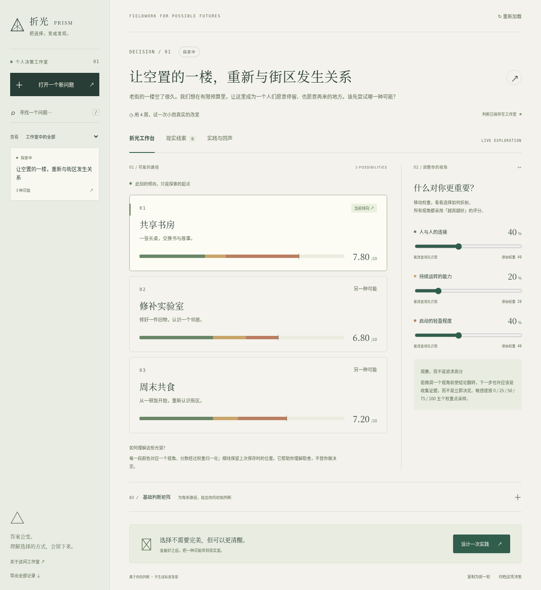

# 折光 PRISM

**把重要的选择，变成可以检验的发现。**

折光是一间单人私有决策工作室。展开几种可能，调整你在意的视角，让取舍以光谱显形；记录现实证据，再锁定当时的判断，带着可观察的假设去实践。最后回来复盘，而不是重写自己的记忆。

这是完整 Vue + Java 应用，分数、证据、实践与复盘真实保存在数据库中，无 AI 密钥、付费服务或外部账户依赖。分数表达主观判断，不是客观成功概率。



## 开始使用
需要 JDK 21、Maven 3.9+、Node.js 24、npm。Linux、macOS 可开发，已验证当前 Debian 云环境。浏览器测试需 Chromium。

```bash
./scripts/build.sh
./scripts/run.sh
```

Java 在本机 8080 提供前端与 API；浏览器打开本机该端口。默认数据库 `data/prism.mv.db`，Flyway 自动建表。开发热更新用 `./scripts/dev.sh`，前端 5173 代理后端 8080。

本次云机器预装的只有 JRE；可运行 `./scripts/cloud-setup.sh` 在 `/workspace/.tools` 安装经签名校验的 Debian JDK 编译组件与 SHA-512 校验的 Maven，并完成全构建。它针对 Debian trixie 和已有 Java 21 JRE，其他系统使用正常 JDK/Maven 安装方式。

## 使用路线
1. 创建问题或明确载入虚构街区示例。
2. 展开「基础判断矩阵」，给各方案按“越高越好”评分。
3. 移动视角权重，观察领先是否翻转；保存判断。
4. 在「现实线索」记录证据，影响程度 × 信心修正分数。
5. 「设计一次实践」锁定快照、假设、信号和复盘日期。
6. 实践后在「实践与回声」记录结论。可以归档、恢复、复制为新一轮。
7. 左下角导出全部 JSON；点品牌或“关于工作室”可导入备份。导入只追加，不覆盖。

## 验证
```bash
./scripts/build.sh                 # Vue 测试、类型检查、前端构建、Java 测试和可执行包
python3 scripts/smoke.py            # 独立临时文件库，重启、回滚、并发、身份验证
cd frontend && npm run e2e         # Chromium，独立 8085/8087 内存库
```

`PRISM_CHROMIUM` 指定 Chromium 可执行文件；默认 `/usr/bin/chromium`。E2E 使用内存数据库，不触碰用户数据。测试证据与局限见 [TESTING](docs/TESTING.md)。

## 容器部署
```bash
cp .env.example .env
# 在本机安全编辑 .env，设置工作室账号、12 字符以上密码和数据库密码
# 不把凭据发到聊天或提交到 Git
chmod 600 .env
docker compose up --build -d
docker compose ps
```

命名卷保存数据；不要随意执行 `down -v`。默认仅发布宿主 loopback。对外访问需自己配置 HTTPS、访问限制及反向代理；本次没有执行任何公网发布。云代理特殊构建用 `python3 scripts/cloud-docker-build.py`，详见 [DEPLOYMENT](docs/DEPLOYMENT.md)。

## 文档
产品思路见 [愿景](docs/PRODUCT_VISION.md)、[需求](docs/PRODUCT_REQUIREMENTS.md)、[设计](docs/DESIGN_SYSTEM.md)；技术见 [架构](docs/ARCHITECTURE.md)、[决策](docs/DECISIONS.md)；交付见 [质量门槛](docs/QUALITY_GATES.md)、[批评审查](docs/CRITIC_REVIEWS.md)、[运维](docs/OPERATIONS.md)。后续会话先读 [AGENTS.md](AGENTS.md) 与 [进度](docs/PROGRESS.md)。

这是单人自托管产品，不提供多人隔离、提醒邮件或 AI 自动决策。没有真实用户研究，不能据功能验证声称市场价值已获证实。依赖许可证见 [第三方说明](docs/THIRD_PARTY.md)。
