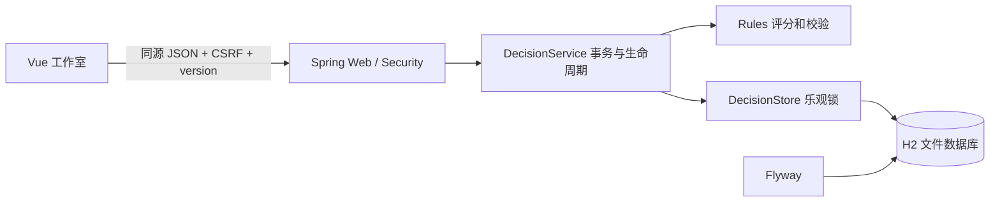

# 架构

Vue 3 + TypeScript + Vite；Java 21 / Spring Boot 3.5.16 / JDBC / H2 / Flyway。生产由 Java 同源提供编译后的 Vue 静态资源，不需要第二个前端服务器。开发由 Vite 代理 /api。

## 持久化
一个决策是聚合：元信息、方案、视角、证据、一个实践与复盘。decisions 表用主键、revision 和 JSON CLOB 存储完整聚合；原子更新整项文档，避免部分更新产生互相矛盾的判断。版本不符或 SQL 条件更新失败返回 409。API 不接受直接写入 experiment，快照只能由服务端构造。Flyway V1 初始化 schema；后续迁移追加文件，勿修改已运行的迁移。

选择聚合文档而非十余张表：单人、每项最多百条证据、500 项决策，读取模式以整项为单位；无需跨记录分析。超出该规模应先增加分页与分表再考虑多人支持。列表返回全部有限聚合，不宜用于大型组织数据。

## API
GET /api/health（公开最小探活）；GET /api/session（CSRF）；GET/POST /api/decisions；GET/PUT/DELETE /api/decisions/{id}；POST evidence、commit、review、archive、fork；DELETE evidence/{evidenceId}?version=N；GET /api/backup；POST /api/restore。
写操作需最新 version，错误 {message}：400 格式、401 身份、403 CSRF、404 缺失、409 冲突、413 请求体过大、422 业务校验、500 诊断编号。日志不写入请求正文或密码。

## 安全
非本地绑定无凭据会启动失败；密码 BCrypt；Basic 凭据仅在页面内存，刷新重新输入，不写 localStorage。浏览器自动携带的 HTTP 会话与 API 写请求均受 CSRF 防护。同源请求，无 CORS 放开。CSP 不允许外部脚本、frame 或任意连接；样式允许 inline 以支持响应式评分条。Vue 文本转义，没有 v-html，不执行来源字段中的 URL。应用不主动访问用户输入的外部地址。

512 KB 请求体限制，字段/集合上限，数据库参数化查询。无证据采集、上传媒体、任意文件路径 API。生产 Basic 必须在 HTTPS 后方；单人认证不等于多租户。匿名本机模式仅适合可信本机环境。
